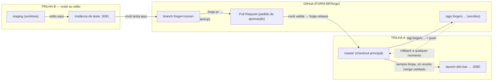

# FORGE — como editamos o DeepSeek Harness sem quebrar o que você usa

> Leia este arquivo com a aba de diagramas aberta — os fluxogramas a seguir são
> Mermaid e renderizam no GitHub e no site de documentação do dsh.

## A ideia em uma frase

O harness que você **usa** e o harness que a gente **edita** são cópias de
trabalho diferentes do mesmo repositório. Mudanças nascem na cópia de edição,
são testadas numa instância separada e só viram "versão nova" quando **você**
valida — sempre com histórico no GitHub.

## As três camadas

| Camada | O que é | Onde vive | Como entra na sua versão |
|---|---|---|---|
| **Composição do perfil** | AGENTS.md, skills, regras de sessão | `~/.dsh` / profile do usuário | Direto, sem build |
| **Plugin / bundle Cordis** | Feature aditiva (tool, skill, página, MCP) | `forge/plugins/` dentro do repo | Instalado no profile — só após validar |
| **Core do harness** | packages/ e apps/ (ex.: rebrand, cost report) | Branch `forge/<nome>` no trabalho | Merge + tag — só após validar |

## As duas trilhas de trabalho



## O ciclo de uma mudança

```mermaid
gitGraph
    commit id: "master validada (a versão que você usa)"
    branch forge/feature
    checkout forge/feature
    commit id: "mudança 1"
    commit id: "mudança 2"
    checkout master
    merge forge/feature tag: "forge/v2026-10-01"
    commit id: "sync upstream (periódico)"
```

1. **`forge new <nome>`** — abre a branch `forge/<nome>` no staging, a partir do
   commit exato que você está usando. A Trilha A nem percebe.
2. **Eu edito e testo** — cada mudança vira um `forge commit "mensagem"`.
3. **`forge dev`** — sobe a instância de teste em `http://127.0.0.1:3081`, com
   dados próprios (`C:\Users\Felipe\Dev\dsh-dev-home`). Seu harness continua no
   `:3080` rodando normalmente.
4. **`forge push` + `forge pr "título"`** — a branch vai pro GitHub e abre o
   **pedido de aprovação** (PR). Nada se perde.
5. **Você testa** na porta 3081. Se não gostou → eu ajusto (nova `forge commit`).
   Se gostou → você diz "válido".
6. **`forge release`** — une a branch na master pelo GitHub, cria a etiqueta
   `forge/v<data-hora>` e publica. Agora existe uma *versão nova* guardada.
7. **Para usar a versão nova** — você só reinicia o `launch-dsh.bat`. E se algo
   estranho aparecer, `forge rollback forge/v<anterior>` volta na hora.

## Regras de ouro (não negociáveis)

- **A master nunca fica suja.** Working tree limpo, sem lixos (rascunhos `.forge-*`
  vão para `C:\Users\Felipe\Dev\forge-worklog`).
- **O processo em uso nunca é tocado.** Mudança só vale no próximo restart — seu.
- **Sem push forçado.** Rollback nunca apaga história; ele cria o caminho de volta.
- **Upstream (melhorias oficiais) entra só na master**, via
  `git fetch upstream && git merge upstream/master`, longe das branches de trabalho.

## Onde está cada coisa

| Item | Caminho |
|---|---|
| Harness que você usa (Trilha A) | `C:\Users\Felipe\Dev\deepseek-harness` |
| Área de edição (Trilha B) | `C:\Users\Felipe\Dev\dsh-staging` |
| Dados/sessões da instância de teste | `C:\Users\Felipe\Dev\dsh-dev-home` |
| Rascunhos, logs, relatórios temporários | `C:\Users\Felipe\Dev\forge-worklog` |
| Script gerenciador | `scripts/forge/forge.ps1` |
| Curso rápido de Git | `docs/FORGE/GIT-101.md` |
| Plugins FORGE | `forge/plugins/` |