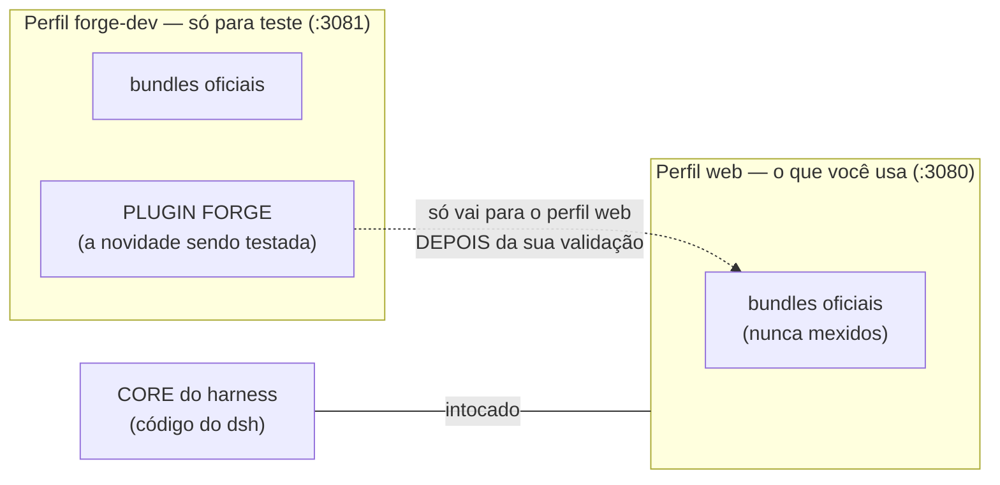

# Plugins FORGE — por que eles não conseguem quebrar o seu harness

Sua preocupação ("um plugin pode quebrar o forge") é correta e é exatamente o
que este fluxo elimina. Entenda a arquitetura:

## As 4 garantias

1. **Plugin é aditivo, não substitui o core.** Um plugin *acrescenta* uma tool,
   uma skill, uma página. Ele roda como uma camada em cima do core — não altera
   o código do harness em si. O core continua intacto.
2. **Ele só vive no perfil onde foi instalado.** Se um plugin quebrar, ele quebra
   **aquele perfil** — e o perfil de teste é descartável: dá para recriar do zero
   com um comando. O seu perfil web (`:3080`) nem enxerga o que está no `forge-dev`.
3. **Remoção é trivial.** Um `dsh plugin --profile <nome> remove <pacote>` tira
   o plugin. Nunca é preciso tocar no código nem no core.
4. **Versionado e testado antes.** Todo plugin nasce em `forge/plugins/`, dentro
   do repositório, com commits. Ele só é instalado no perfil de teste até você
   validar. Só depois de aprovado é que (se você quiser) entra no perfil de uso.

## O ciclo de um plugin

1. Crio o plugin em `forge/plugins/<nome>/` na branch `forge/<nome>`.
2. `forge dev` → instalo só no perfil `forge-dev` (instância `:3081`).
3. Você testa. Se quebrar alguma coisa: quebra **só** o `forge-dev` — o seu
   `:3080` continua de pé, e a remoção é um comando.
4. Você valida → release normal (merge + tag), e o plugin vira parte da versão.

## Regras para plugins FORGE

- Sempre em `forge/plugins/<nome>/` com `package.json` próprio e `README.md`.
- `forge commit` com descrição em português do que o plugin faz.
- Nunca instalar no perfil de produção sem validação explícita sua.
- Plugin que precise de credencial = a credencial fica no profile (fora do git),
  nunca no código.